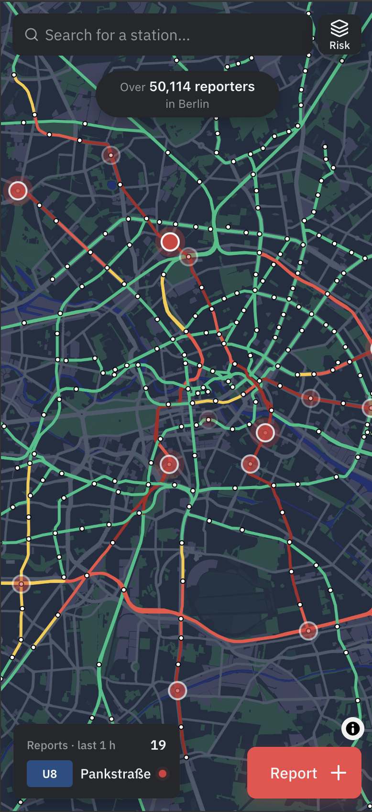
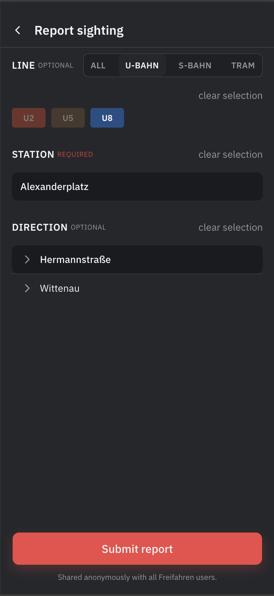

<div align="center">
  <picture>
    <source media="(prefers-color-scheme: dark)" srcset="docs/readme_assets/logo-white.png" />
    
  </picture>

  <h1>FreiFahren</h1>

  <p>Die Live-Karte der Ticketkontrolleure im Berliner Nahverkehr</p>

  [](https://t.me/freifahren_BE)
  [](LICENSE)
  [](https://github.com/FreiFahren/FreiFahren/actions/workflows/frontend-next-ci.yml)
  [](https://github.com/FreiFahren/FreiFahren/actions/workflows/api-worker-ci.yml)
  [](https://github.com/FreiFahren/FreiFahren/actions/workflows/telegram-worker-ci.yml)
</div>

---

## What is FreiFahren?

FreiFahren crowdsources real-time sightings of ticket inspectors across the Berlin public transport network. Reports flow in from the in-app form or the [FreiFahren Telegram group](https://t.me/freifahren_BE); the community keeps the map accurate.

<div align="center">
  
  &nbsp;&nbsp;
  
</div>

---

## How it works

1. **Report**: community members spot a ticket inspector and submit the station, line and direction via the web app or the [Telegram group](https://t.me/freifahren_BE)
2. **Process**: the backend validates the report and writes it to the database
3. **Display**: the live map updates in real-time so everyone can see where inspectors are right now

## Development

With [Bun](https://bun.sh) and [just](https://just.systems) installed:

```sh
just setup   # dependencies, local env files, seeded local databases
just dev     # API on :8787, frontend on :1871
```

Sign-in, the Fund and report scoring are private services, so locally sign-in and the Fund are
hidden and the API accepts reports without scoring them, the way pull request previews do.

## Contributing

Pull requests are welcome. FreiFahren's maintainers develop this repository together with some private services in an internal repository, and [Copybara](https://github.com/google/copybara) keeps the two in sync:

1. Once a maintainer has had a first look and labeled your pull request `import`, a bot copies it into the internal repository for review, and again whenever you push to it.
2. Once it's accepted, the change is published back here, with you as its author, and your pull request shows as merged.

So open and update pull requests here as usual; you don't need access to anything else.

## Contact

Questions or feedback? Reach us at [contact@freifahren.org](mailto:contact@freifahren.org).

Or personally via [johan@freifahren.org](mailto:johan@freifahren.org), [moritz@freifahren.org](mailto:moritz@freifahren.org) or [david@freifahren.org](mailto:david@freifahren.org).
